# Hoja de vida web · Sebastian Sierra

Sitio web personal de demostración que presenta una hoja de vida, habilidades, formación académica y proyectos mediante un diseño adaptable a celulares, tabletas y computadores.

**Sitio publicado:** https://juansebastiansierravelasco.github.io/Hojadevida/

**Repositorio:** https://github.com/juansebastiansierravelasco/Hojadevida.git

## Páginas del sitio

- `index.html`: hoja de vida y perfil profesional.
- `proyectos.html`: presentación de proyectos.
- `contacto.html`: información de contacto mediante correo electrónico.

## Mockups del diseño inicial

Los siguientes mockups fueron realizados en Paint antes de desarrollar las páginas web.

### Hoja de vida

**Vista en celular**

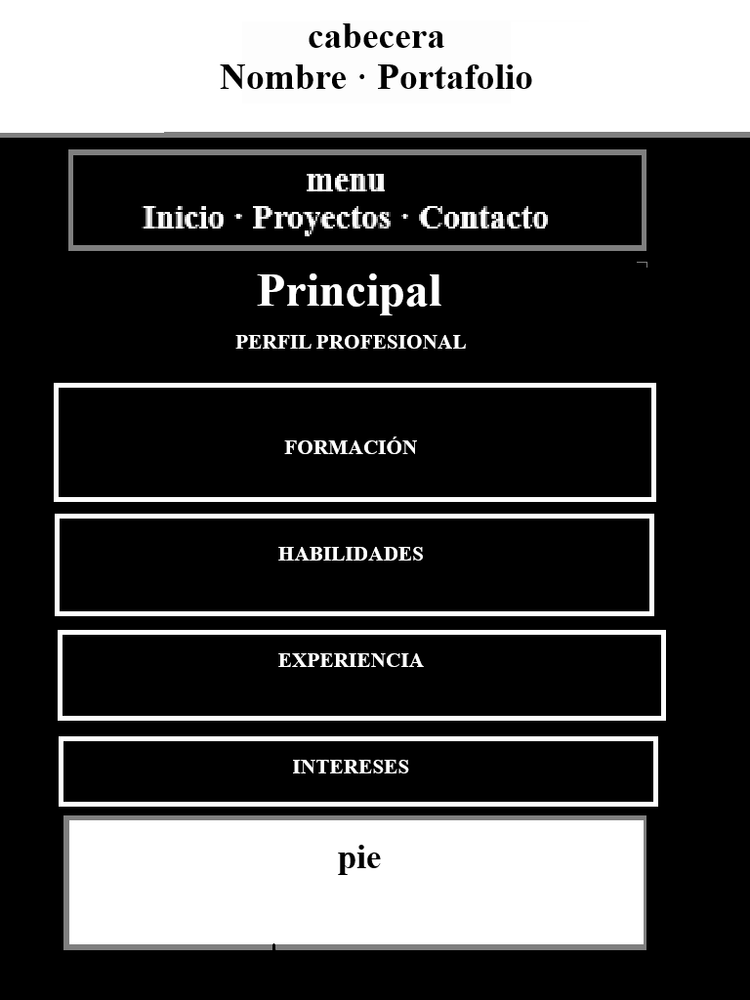

**Vista en computador**

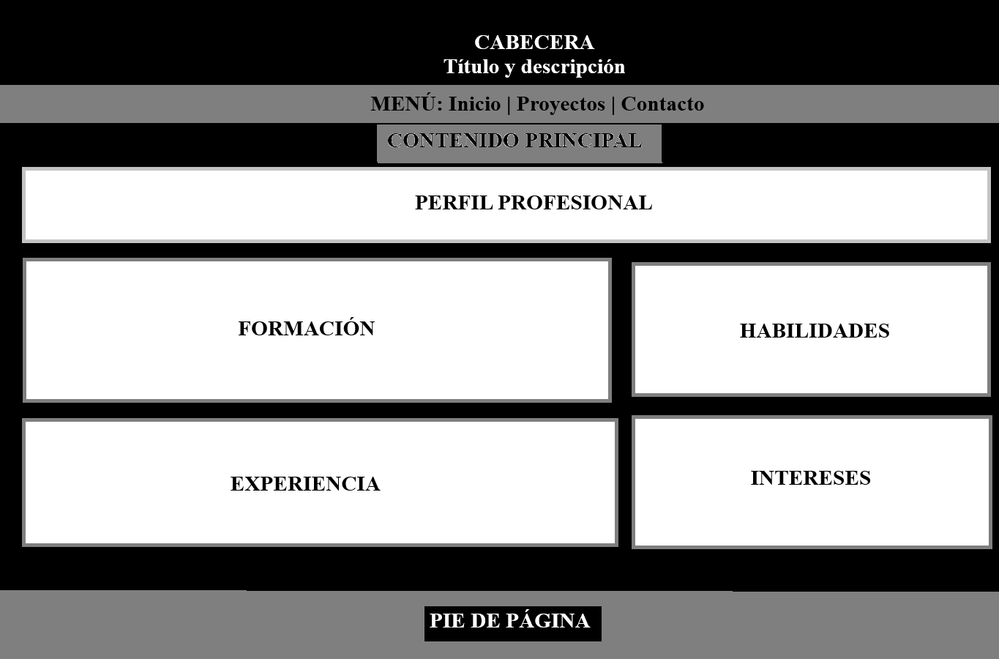

### Proyectos

**Vista en celular**

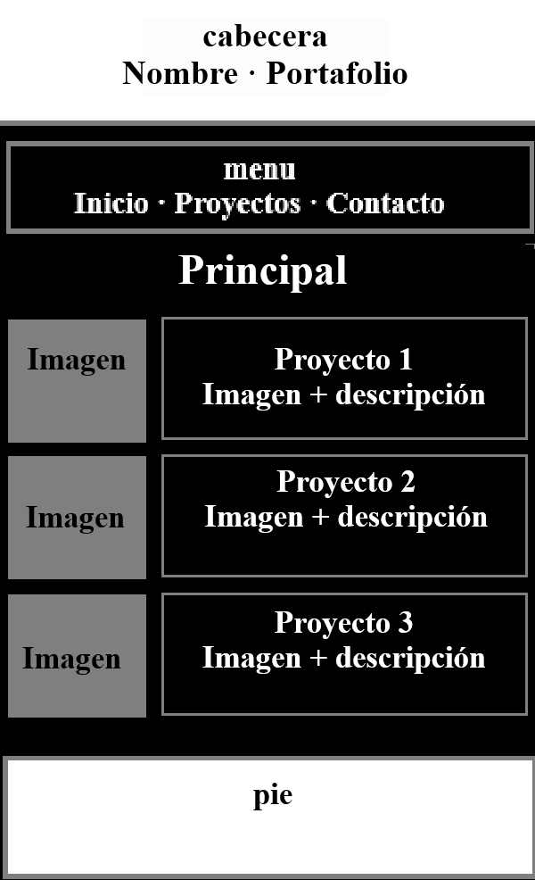

**Vista en computador**

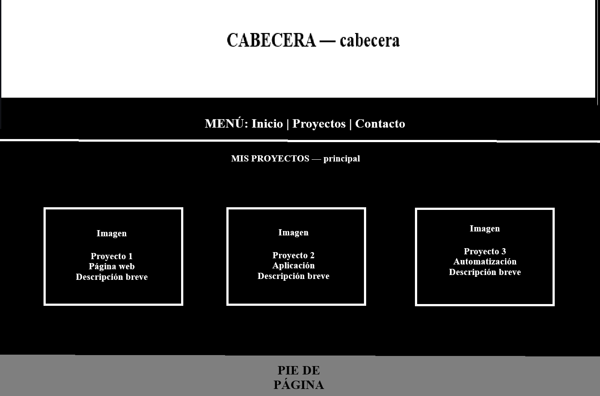

### Contacto

**Vista en celular**

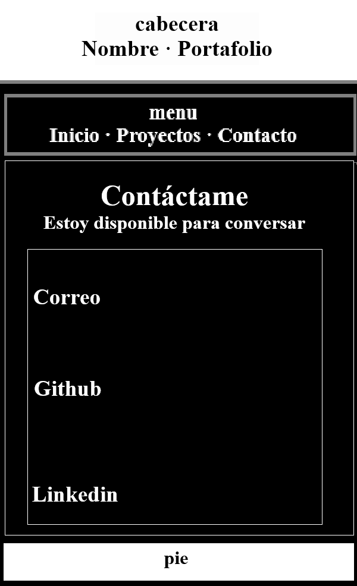

**Vista en computador**

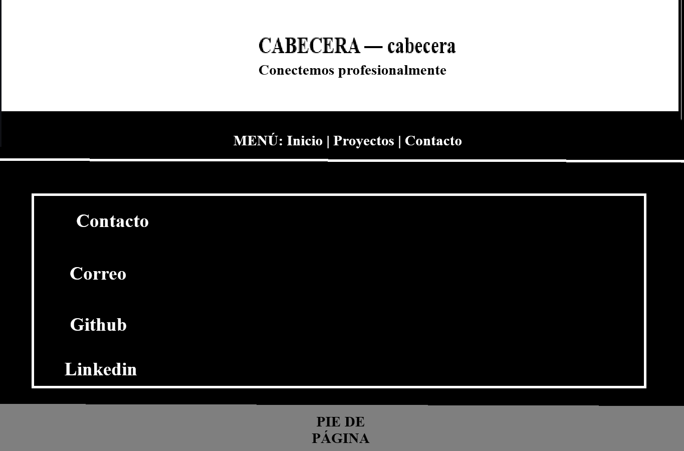

## Capturas del sitio web terminado

En esta parte del Readme se muestra el resultado final de las páginas web funcionando en el navegador, tanto en computador como en celular.

### Inicio

**Vista en computador**

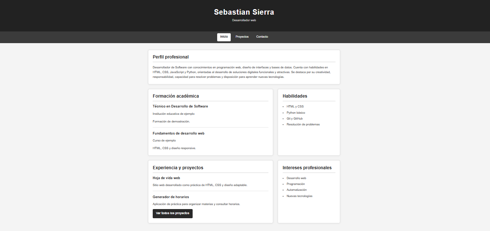

**Vista en celular**

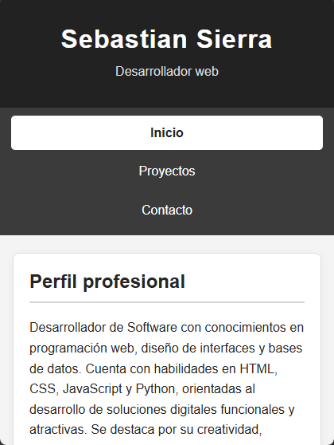

### Proyectos

**Vista en computador**

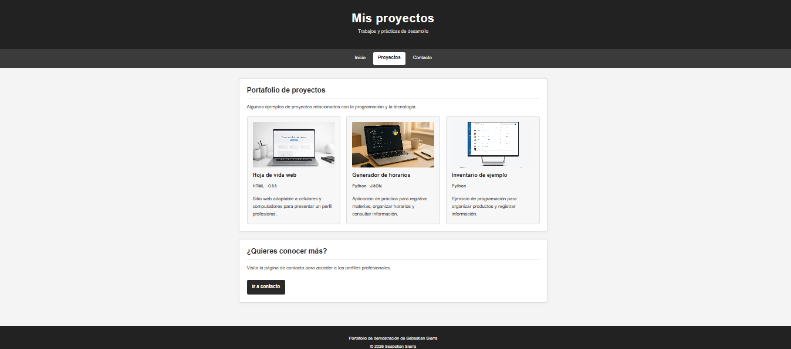

**Vista en celular**

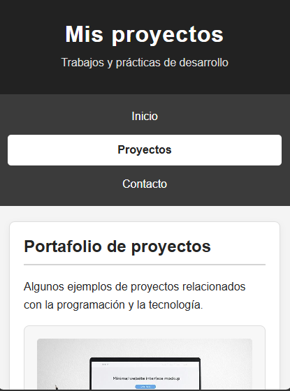

### Contacto

**Vista en computador**

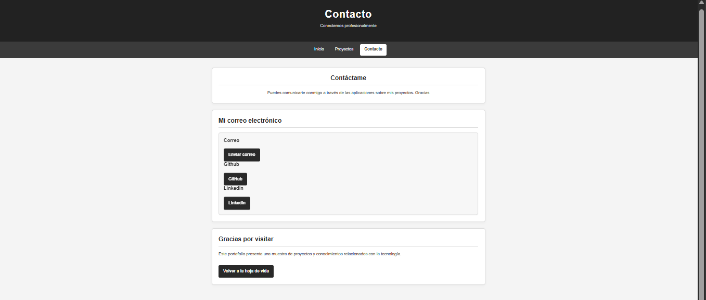

**Vista en celular**

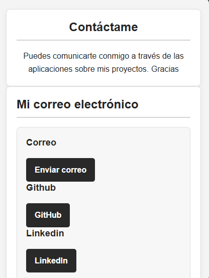

El sitio se desarrolló con un enfoque *mobile-first*, comenzando por el diseño para pantallas pequeñas.

- **Menos de 600 px:** el menú se organiza verticalmente y las secciones se muestran en una columna.
- **Desde 600 px:** el menú se distribuye horizontalmente y se ajustan los espacios y el tamaño de las tarjetas.
- **Desde 1024 px:** la hoja de vida utiliza una distribución de varias columnas y las tarjetas de proyectos se organizan en tres columnas.

Se utilizaron CSS Grid, Flexbox, imágenes adaptables y media queries para ajustar la presentación según el ancho disponible.

## Cómo publiqué el sitio

1. Creé los archivos HTML para las páginas de inicio, proyectos y contacto.
2. Elaboré los estilos en CSS para definir los colores, la distribución y el diseño responsive.
3. Dibujé los mockups de las páginas en Paint, en versiones para celular y computador.
4. Probé las páginas en el navegador y revisé que quedaran bien para  tamaño de cada una de  las pantallas.
5. Creé un repositorio público en GitHub y subí los archivos del proyecto.
6. Configuré GitHub Pages para publicar el sitio web.
7. Tomé capturas de pantalla del resultado final en computador y celular.

## Fuentes consultadas

- [MDN Web Docs: HTML](https://developer.mozilla.org/es/docs/Web/HTML)
- [MDN Web Docs: CSS](https://developer.mozilla.org/es/docs/Web/CSS)
- [MDN Web Docs: Diseño web adaptable](https://developer.mozilla.org/es/docs/Learn_web_development/Core/CSS_layout/Responsive_Design)
- [GitHub Docs: GitHub Pages](https://docs.github.com/es/pages)

## Autor

**Sebastian Sierra**

Proyecto académico: Hoja de vida web responsive.

Año: 2026.

